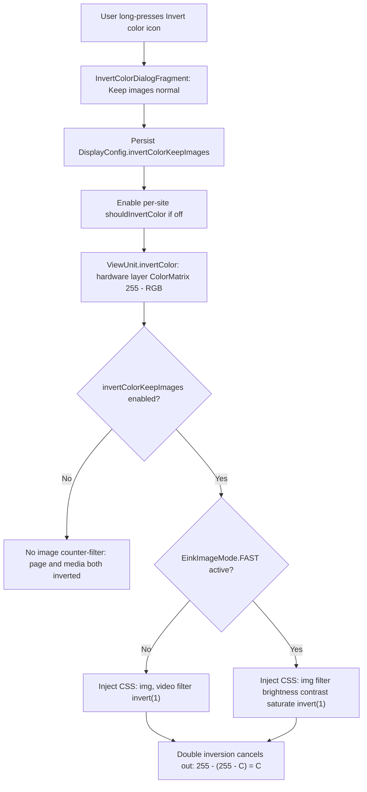

2026-11-24

# Keeping Images Normal Under Page Color Inversion in EinkBro

## Why Page Color Inversion Turns Photos into Negatives

EinkBro implements per-site page color inversion (`ViewUnit.invertColor`) by attaching a hardware-layer `Paint` with a `ColorMatrixColorFilter` to the `EBWebView`:

$$R' = 255 - R, \quad G' = 255 - G, \quad B' = 255 - B$$

Because this filter runs on the WebView's hardware layer at composition time, it inverts every pixel uniformly—turning light backgrounds dark and dark text light without touching site stylesheets, but also inverting photographs, illustrations, and videos into color negatives.

To address issue #652, long-pressing the **Invert color** icon in the menu dialog (or on the toolbar) now opens `InvertColorDialogFragment`, allowing the user to toggle a global **Keep images normal** preference (`DisplayConfig.invertColorKeepImages`) while applying color inversion to the current page.

## Choosing Compositor CSS Counter-Inversion Over Bitmap Re-encoding

EinkBro has two image-processing paths:
1. **Network-layer bitmap processing (`EinkImageProcessor` / `EinkImageInterceptor`)**: Used in Deep E-ink Image Optimization mode to decode network images with `BitmapFactory`, apply gamma lift, saturation boost, S-curve contrast, and 16-level Floyd-Steinberg dithering, and re-encode them to JPEG/PNG/WebP.
2. **Compositor CSS filter (`WebViewReaderHelper.einkImageFilterCss`)**: Used in Fast E-ink Image Optimization mode to inject a CSS `filter` into the main style slot (`einkbro-css-main`).

Counter-inverting images at the CSS compositor layer (`filter: invert(1)`) is strictly superior to inverting pixels inside `EinkImageProcessor`:
- **Lossless double inversion**: Chromium's compositor inverts rendered media channels ($255 - C$) in memory right before Android's hardware-layer `ColorMatrixColorFilter` inverts the WebView surface ($255 - (255 - C) = C$). There is no JPEG/WebP re-compression at quality 85 and no `inSampleSize` downsampling.
- **Preserves Deep E-ink dithering**: When Deep E-ink Image Optimization is active, `EinkImageProcessor` still runs its shadow lift and Floyd-Steinberg dithering in normal color space; the subsequent CSS `invert(1)` and hardware-layer inversion cancel out cleanly without re-compressing the dithered pixel grid or splitting `EinkImageCache` keys.
- **Complete media coverage & instant toggling**: Applies immediately to already-loaded images without a page reload, and covers formats that `EinkImageInterceptor` skips (images under 128 px, animated GIFs, inline SVGs, `data:`/`blob:` URIs, and `<video>` elements).



## Composing With Fast E-ink Image Filters and Avoiding Double Inversion

Two subtleties arise when injecting the CSS counter-filter in `WebViewReaderHelper.einkImageFilterCss(url)`:

1. **Filter ordering with Fast E-ink Image Optimization**: When `EinkImageMode.FAST` is active alongside `invertColorKeepImages`, both adjustments must live in a single `filter` declaration so neither rule overwrites the other, and `invert(1)` must come *after* `brightness(...) contrast(...) saturate(...)`:
   ```css
   img { filter: brightness(...) contrast(...) saturate(...) invert(1) !important; }
   video { filter: invert(1) !important; }
   ```
   Running the tone and saturation lift first adjusts the image in normal color space before `invert(1)` pre-inverts it for Android's hardware layer.
2. **Selector choice (`img, video` without `picture`)**: Targeting `picture` in addition to `img` would apply `invert(1)` to both the `<picture>` wrapper and its child ``, double-inverting responsive images back into negatives. Scoping the rule to `img, video` inverts each rendered media element exactly once.
3. **Keeping hardware layer and CSS slot in lockstep**: `DisplayConfigDelegate.invertColors()` and `NinjaWebViewClient.onPageStarted()` now update `ViewUnit.invertColor` and `ebWebView.updateCssStyle()` together so toggling color inversion or navigating across site rules never leaves the CSS counter-filter out of sync with the hardware layer.
