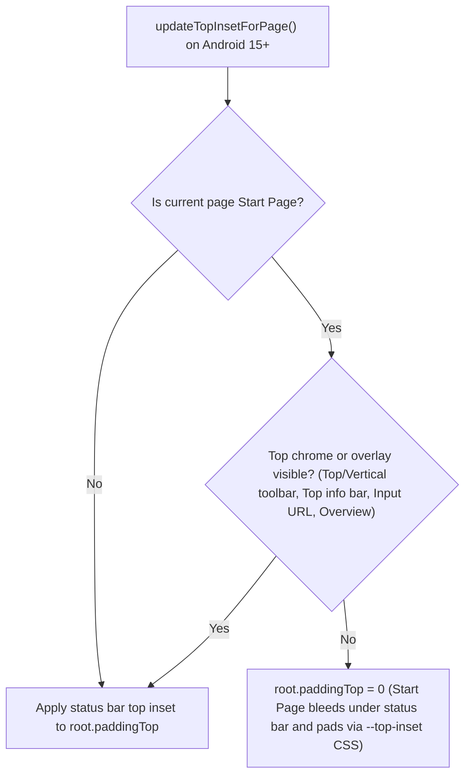

2026-11-22

# Keep top toolbar and tab bar below the status bar on the start page

Issue #655 reported that on Android 15 (Fairphone 4) with the toolbar placed at the top and the tab bar visible, force-stopping and launching EinkBro caused the tab bar to render directly over the Android status bar and camera cutout.

Under targetSdk 36, Android 15+ forces windows edge-to-edge. The initial edge-to-edge handling in `ChromeSetupDelegate.updateTopInsetForPage()` padded `binding.root` by the status bar top inset on regular web pages, but unconditionally set `root.paddingTop = 0` whenever the active WebView was showing `einkbro://start-page` so a custom start-page background could bleed behind the transparent status bar and pad its own body via the `--top-inset` CSS variable.

That opt-out assumed the WebView occupied the top edge of the window. When the toolbar was positioned at the top (or vertically on the left or right, or with the in-app info bar or full-screen input/overview overlays at the top), those native views sat above the WebView and were pushed straight into the system status bar whenever the start page was active. In addition, `binding.root` had no explicit background color, so when `root.paddingTop` was non-zero the padded status bar band fell through to the dark framework Material window background instead of matching the active app theme, and `start_page.html` still applied `--top-inset` inside the WebView below the top toolbar.

Commit c00e7a53c restricts the start-page zero-inset opt-out to when the WebView itself sits at the top edge (`toolbarPosition == ToolbarPosition.Bottom`, no top info bar, and neither the URL input bar nor the overview panel visible). Whenever native chrome occupies the top edge, `root.paddingTop` retains the status bar inset and `--top-inset` in the start page is set to `0px` so the page does not double-pad. `EBWebView` also records `currentPageUrl` synchronously in `loadStartPage()` and `loadUrl()` so initial window-inset passes during cold launch see the target URL before `WebView.getUrl()` commits asynchronously, and `binding.root` is painted with `ThemedBorders.baseArgb(activity)` while syncing `isAppearanceLightStatusBars` and `isAppearanceLightNavigationBars` to the theme background luminance.

Verified with unit tests and on an Android 16 emulator using `sim-use` across bottom toolbar, top toolbar with tab bar, URL input overlay, and cold start after force stop.

Issue: https://github.com/plateaukao/einkbro/issues/655
Commit: https://github.com/plateaukao/einkbro/commit/c00e7a53c
