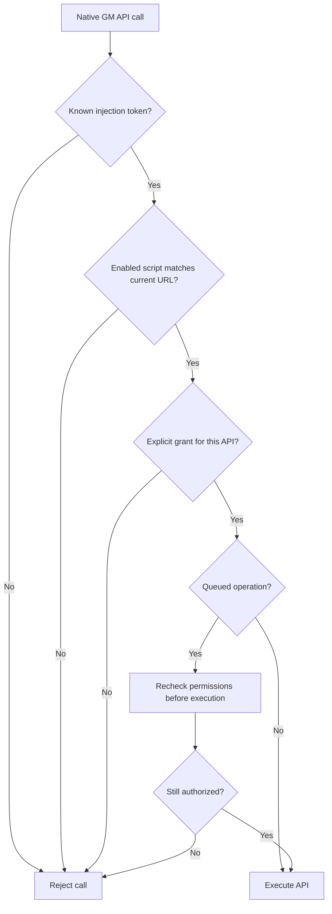

2026-10-17

# Restrict userscript native APIs by site and explicit grants

The userscript bridge exposed every native GM method in every WebView, including when no userscripts were installed. Existing injection tokens checked script identity and URL matching, but ignored the script's `@grant` declarations. The JavaScript shim also published all GM functions on `window`, allowing page code and other userscripts to call those privileged closures.

Native operations now require a valid injection token, an enabled script matching the current page URL, and an explicit grant for the particular API. The authorization check reads one cached script snapshot so its enabled state, URL rules, exclusions, and grants are evaluated together. Legacy `GM_*` grants and modern `GM.*` grants are supported, including the XHR capitalization aliases. Omitted grants and `@grant none` provide no native capabilities.

The shim returns a private namespace containing only the granted APIs. Script dependencies and the script body run inside a wrapper that binds that namespace locally instead of exporting GM functions on `window`. A script that can read its stored values does not automatically receive clipboard, tab-opening, networking, or storage-writing access. Page-only scripts continue to run without a native bridge.

The manager reports whether any enabled installed script declares a supported native API grant. Each WebView observes this state and attaches the bridge only when needed. Disabling or deleting the last such script clears its tokens and schedules bridge removal; destroying a WebView cancels its observer and clears its tokens. Queued UI actions and XHR callback delivery recheck authorization before running, so navigation or permission changes can invalidate pending work.

Android WebView exposes a JavaScript interface as one object and applies attachment changes on the next page load. Consequently, the raw object can remain visible on a site without a matching script when another installed script needs it. Its native calls are still denied unless the current script, site, token, and API grant authorize them. Scripts continue to execute in the page's JavaScript world; this change does not introduce an isolated JavaScript sandbox. Scripts that relied on undeclared GM APIs must add the appropriate grants.

Seven targeted Kotlin tests passed, covering metadata grants, matching and excluded URLs, disabled scripts, invalidated tokens, native storage authorization, and grant revocation before a queued tab action executes. The standalone Node shim checks also passed, covering private API bindings, denied functions, separate script namespaces, and XHR aliases. `git diff --check` passed. Live device verification was unavailable because no Android device or emulator was connected.

Implementation: [03632653f](https://github.com/plateaukao/einkbro/commit/03632653f).
