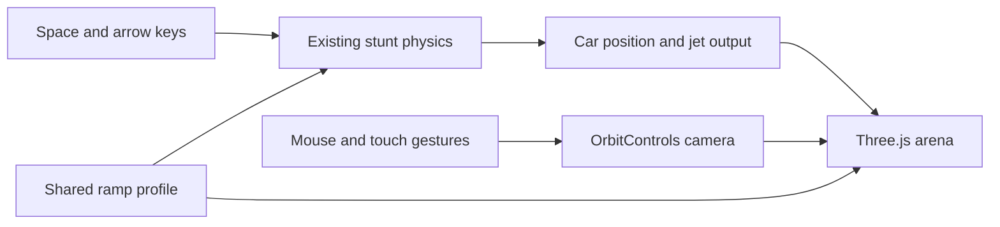

2026-10-17

# Gripfall: a 3D arena with a draggable camera

Gripfall now renders its cinematic stunt arena with Three.js. Players can drag with the left mouse button to orbit, scroll to zoom, or drag with the right mouse button to pan. One-finger touch orbits, and two fingers zoom and pan. Reset view restores the original framing without restarting the run.

The road surface, thickness, rails, steel supports, landing lights, car, shadows, exhaust, flight trail, and touchdown dust are real 3D objects. The road follows the same sampled profile as the existing physics, preserving the tall narrow climb, the upper hook past vertical, the reverse-direction launch, and the distant landing zone.

The simulation remains in its established vertical plane. Mouse gestures affect the camera independently; Space still drives, Up applies suction, and Down produces lift. OrbitControls does not register arrow-key camera controls. On phones the camera follows the car while preserving the chosen orbit angle. The HTML controls retain their actual-input highlights during demos, and no pause control or ramp label is added.

Three.js 0.186.1 and OrbitControls are bundled with pinned esbuild tooling. The committed classic-script bundle works directly from a local index.html and on GitHub Pages without a CDN or build service. The source, dependency lockfile, and Three.js MIT license are included; WebGL 2 is required.

Verification passed the existing physics assertions and Chrome browser checks for WebGL rendering, mouse orbit/zoom/pan, camera reset after inertia, arrow-key isolation, simultaneous drive and vacuum touches, touch orbit, live command highlights, and successful desktop and 390px mobile demo landings. Browser checks also reject geometry buffer warnings and JavaScript errors. The demo still lands in about 15.5 seconds with 62 percent fuel remaining.

Implementation commit: [feb6c9b](https://github.com/plateaukao/gripfall/commit/feb6c9b).
