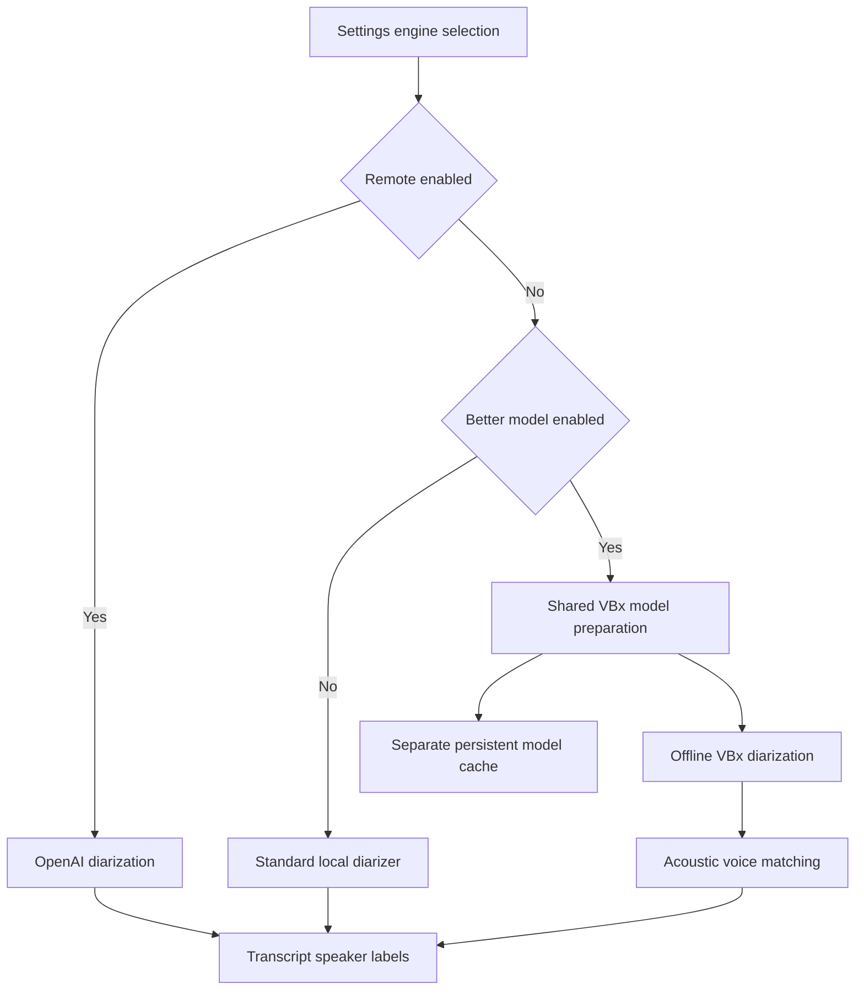

2026-10-13

# WhisperASR: optional offline VBx diarization and reasoning-model compatibility

Completed recordings can now use FluidAudio's full-file offline VBx pipeline instead of the standard local diarizer. The new "Use better diarization model" switch under Settings > Speakers downloads and prepares the additional models immediately. The default remains the standard local pipeline, and the existing remote OpenAI option still takes precedence when selected.

Settings and transcription share one model-preparation task, preventing duplicate downloads. Errors disable the option and provide a retry path. Models are stored in a separate persistent cache under Application Support/WhisperASR/Models/Diarization-VBx, so disabling VBx retains its files and does not replace the standard diarizer's cache. The downloaded files total approximately 21.8 MB, excluding system-managed compilation caches.

Known voices are processed with the offline pipeline and compared using normalized original acoustic embeddings. VBx clustering-space centroids and previously cached legacy embeddings are not interchangeable with these references. Clusters without visible speaker turns are excluded from matching, and offline references do not overwrite legacy cached embeddings. Settings backup includes the new preference as an optional field, preserving compatibility with older backups.

Translation and meeting-minutes requests previously hard-coded temperature 0.3. GPT-6 Luna rejects that parameter in its default reasoning mode. Both request builders now omit temperature for every selected model, including future models, allowing the service to apply its supported defaults. Existing model configuration is preserved; the pending default-model change to gpt-5.4 is included with corresponding documentation.

Contributor guidance moved from CLAUDE.md to AGENTS.md, with detailed implementation notes preserved in docs/architecture.md. CLAUDE.md links to the maintained guidance.

Validation passed for engine routing, backup compatibility, actual VBx model loading and local inference, and reference-clip recognition. Settings automation confirmed model readiness when enabled and restored the original selection. Live GPT-6 Luna translation and meeting-minutes checks passed using synthetic text only. The source commit is 2050cd4.
