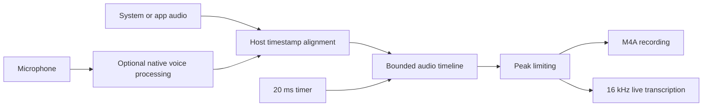

2026-10-26

# WhisperASR records all system audio with a continuous microphone timeline

WhisperASR can now record all system audio without choosing an application, optionally including the microphone. The recording dialog offers All System Audio and Specific App, remembers source and microphone preferences, and includes them in settings backups. ScreenCaptureKit captures the digital audio while excluding WhisperASR's own playback. Existing app recording remains available; Zoom meeting monitoring applies only to that mode.

The previous microphone mixer drained samples only when app-audio callbacks arrived. This coupled speech recording to system playback and could delay or discard microphone input during silence. It also combined streams without aligning their timestamps and hard-clipped their sum.

The replacement places ScreenCaptureKit presentation timestamps and microphone host timestamps on one monotonic 48 kHz timeline. A serial queue emits 20 ms blocks with 300 ms of buffering for delivery jitter, fills missing input with silence, and limits peaks before feeding both the M4A writer and live transcription. Pending samples are bounded to five seconds, late input is trimmed, and stopping flushes the delayed tail, including a final partial block. Initial capture and stream recovery share the same source filter construction.

An optional Reduce speaker echo setting enables AVAudioEngine voice processing before querying the microphone format. Other-audio ducking is set to the minimum supported level. Audio device changes rebuild the microphone engine while retaining the recording timeline. Missing devices, denied microphone access, and startup failures are shown in the dialog instead of silently dropping the microphone. The recording window identifies its source and microphone status and displays capture errors.

Validation passed 20 tests; four optional model-inference tests were skipped. Eight recording tests cover microphone-only intervals, timestamp ordering, late and overlapping input, partial final blocks, invalid samples, peak limiting, and actual M4A encoding and reopening. A signed release was installed and its signature verified. A hardware system-audio recording captured 440 Hz and 880 Hz signals with the intended three-second silent interval and produced a playable 55.596-second M4A. The source picker and preferences were checked in the native UI.

The test Mac reported speakers but no microphone input device. The missing-microphone path was verified, but microphone capture and acoustic echo-reduction quality still require a test with an available input device. Native voice processing can affect other playback volume; users can disable it for unprocessed microphone capture.

Implementation commit: 5ea77f1 (feat: record all system audio with timestamped microphone mixing).
