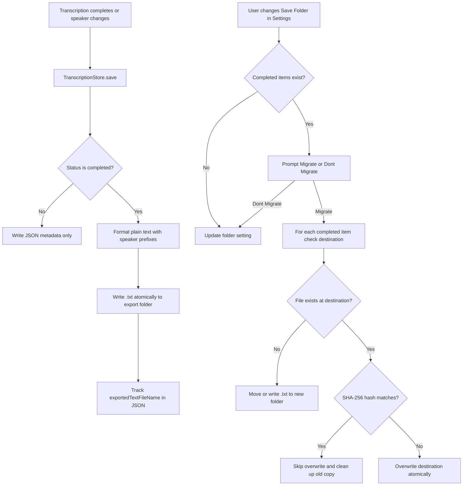

2026-11-26

# WhisperASR: Auto-Saving Plain-Text Transcripts to a Configurable Folder

WhisperASR previously stored transcripts only as internal JSON files under `~/Library/Application Support/WhisperASR/Transcriptions/`, requiring a manual **Export Text...** step whenever a user wanted a readable `.txt` file for another tool or archive. Because speaker diarization and manual speaker naming happen after initial transcription, manually exported files also drifted out of sync whenever speaker labels changed.

## What Changed

Completed transcriptions are now automatically written as plain-text `.txt` files alongside the internal JSON store, in a default folder that users can configure in **Settings -> Transcriptions**:

- **Default location**: Starts at `~/Library/Application Support/WhisperASR/Transcriptions/` (alongside the internal JSON store, which only reads `.json` files) and can be changed to any directory via **Choose...** or restored with **Reset to Default**. The setting is stored in `UserDefaults` (`transcriptionExportFolderPath`) and included in settings backups.
- **Automatic speaker and rename sync**: `TranscriptionStore.save(_:)` writes the `.txt` file whenever an item's status is `.completed`, using a shared `SubtitleFormatter.plainText(segments:fallbackText:)` helper so Copy Content, manual export, and auto-saved files stay identical. Because diarization (`AppState.diarizeItem`) and speaker identification (`SpeakerAssignmentView.saveAssignments`) both persist through `TranscriptionStore.save(_:)`, any speaker recognition change immediately updates the `.txt` file in place.
- **Stable filename tracking**: Each `TranscriptionItem` persists `exportedTextFileName` in its JSON record. Repeated saves overwrite the same `.txt` file rather than creating numbered duplicates, while renaming an item writes the new `.txt` filename and removes the old one cleanly.
- **Migration with SHA-256 deduplication**: When the user changes the save folder and completed transcriptions exist, Settings asks whether to **Migrate**, **Don't Migrate**, or **Cancel**. Migrating moves existing `.txt` files (and generates `.txt` files for older completed items that were transcribed before this feature). If the destination folder already contains a file with the same name, its SHA-256 hash is compared against the source: identical files are left untouched (preserving timestamps and avoiding redundant writes), while differing files are overwritten atomically.

